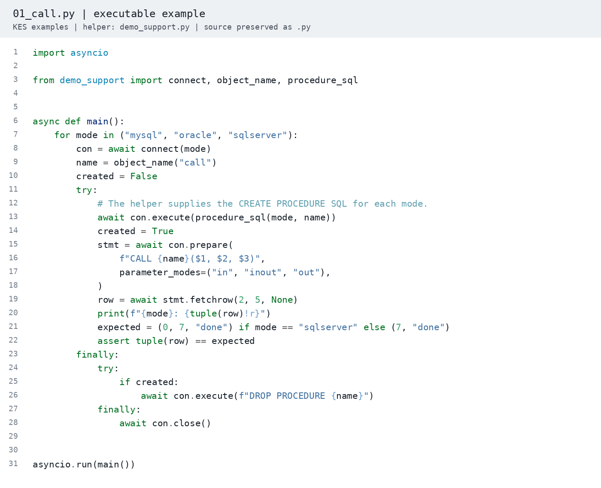
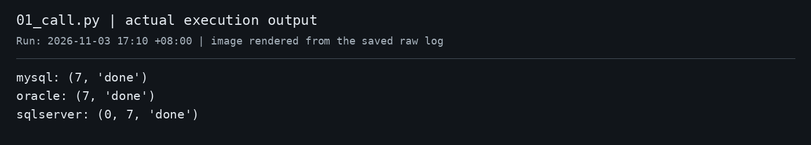
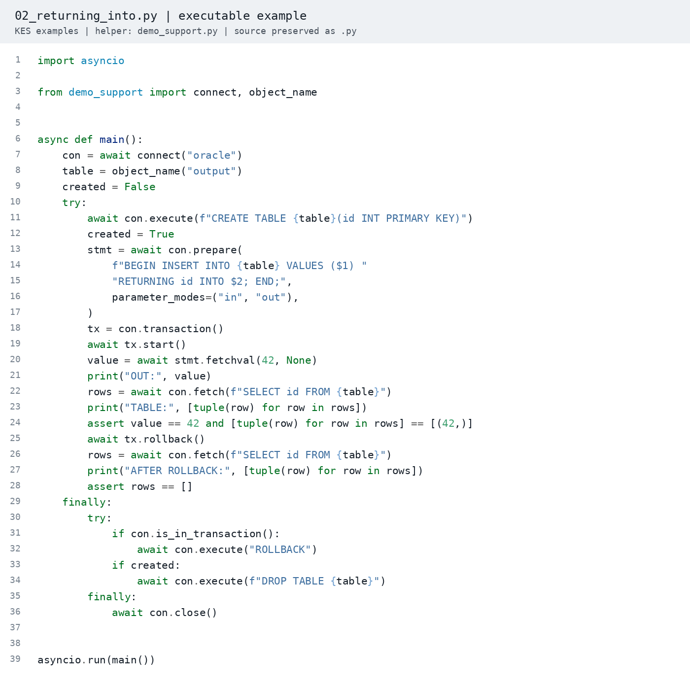
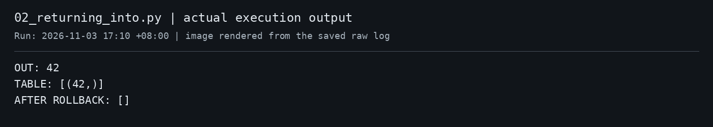
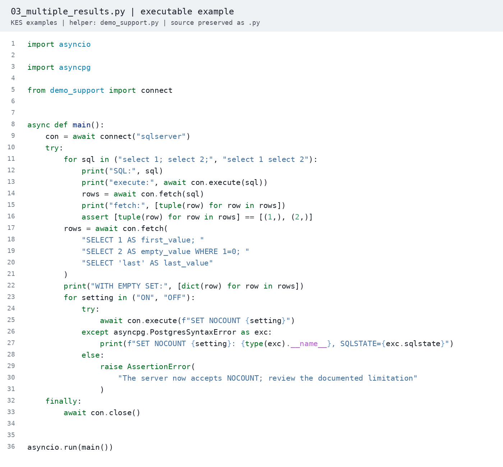
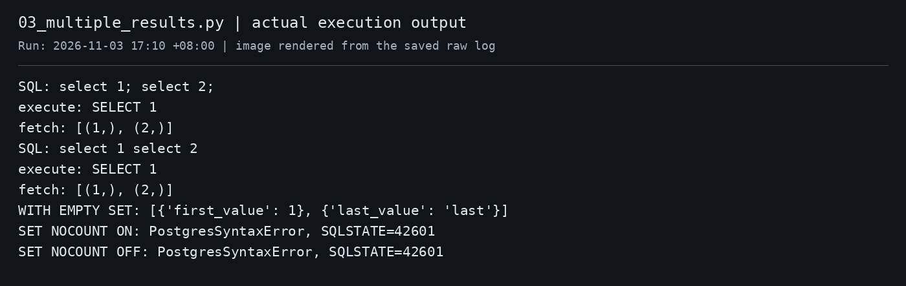
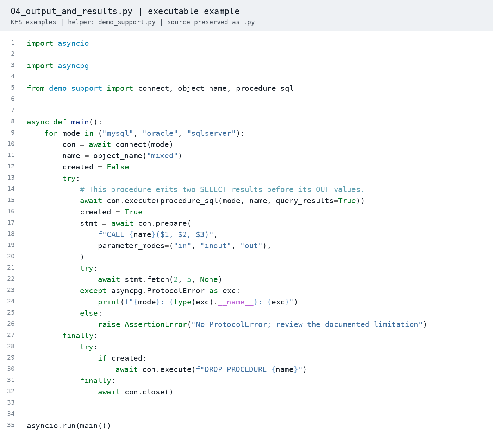
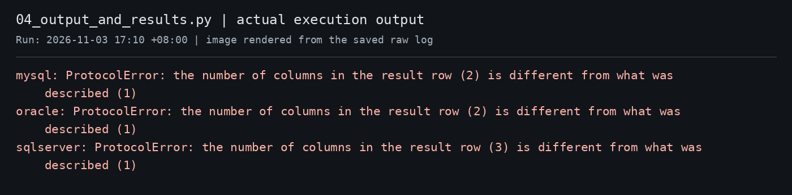

# 存储过程与输出参数：典型使用说明

本目录是需求文档的配套示例和图片，不修改驱动实现。
四个示例于 2026-11-03 17:10 在当前源码及本地三模式实例上实际运行。
`*_result.png` 是由对应原始 `.txt` 日志排版生成的实测输出图片，
不是桌面终端截图；`*_code.png` 与同名 `.py` 源码对应。

## 运行方式

在项目根目录执行，先在终端设置 `ASYNCKB_KES_PASSWORD`：

```bash
read -rsp 'KES password: ' ASYNCKB_KES_PASSWORD
export ASYNCKB_KES_PASSWORD
PYTHONPATH=. python3 docs/_static/kes-testing/procedure-examples/01_call.py
PYTHONPATH=. python3 docs/_static/kes-testing/procedure-examples/02_returning_into.py
PYTHONPATH=. python3 docs/_static/kes-testing/procedure-examples/03_multiple_results.py
PYTHONPATH=. python3 docs/_static/kes-testing/procedure-examples/04_output_and_results.py
```

默认连接本机 `test` 数据库，用户为 `system`，MySQL／Oracle／SQL Server
端口依次为 54321／54322／54323。可通过与测试目录相同的 `ASYNCKB_KES_*`
环境变量覆盖地址、端口、用户和数据库。示例仅创建并删除带随机后缀的自身对象。
`demo_support.py` 提供连接配置及三模式对应的建过程语句；运行时需与示例放在同一目录。

## 示例一：三模式 CALL 的 IN、IN OUT、OUT

用途：过程接收输入值 2，将 IN OUT 初始值 5 加上 2，
并通过 OUT 返回字符串 done。示例不同时返回过程内部查询结果集。

[完整代码](01_call.py) / [建过程与连接辅助代码](demo_support.py)





MySQL／Oracle 返回 `(7, 'done')`。SQL Server 返回 `(0, 7, 'done')`，
第一列为 `_retval_` 返回状态，不是 p_total。

## 示例二：Oracle 普通 DML 的 RETURNING INTO

用途：在匿名块中插入 id=42，通过 OUT 取得插入的 id，查询表数据，
然后回滚并再次检查表为空。匿名块不创建存储过程，也不替代显式事务。

[完整代码](02_returning_into.py)





输出依次为 `OUT: 42`、`TABLE: [(42,)]`、`AFTER ROLLBACK: []`。
该结果只证明匿名块路径通过，不代表独立 SQL 的 RETURNING INTO 通过。

## 示例三：SQL Server ZIP 中的两个多 SELECT 写法

用途：对分号分隔及空格分隔的两个 SELECT，分别使用 execute() 和 fetch()。
另补充空结果集及原 SET NOCOUNT ON/OFF 语法的限制验证。

[完整代码](03_multiple_results.py)





execute() 返回最后一条命令的状态 `SELECT 1`，不返回查询行；
fetch() 返回合并行 `[(1,), (2,)]`，不能据此认定结果集可分组遍历。
中间空结果集不保留列表位置。当前服务器拒绝原 SET NOCOUNT ON/OFF，
SQLSTATE 为 42601；不能把该限制测试写成原语法已兼容。

## 示例四：OUT 与多个查询结果同时返回的限制

用途：在示例一的过程内增加两次查询，再读取过程输出，
复现基础 CALL 通过但 OUT／多结果集组合失败的区别。

[完整代码](04_output_and_results.py) / [完整过程定义](demo_support.py)





三模式均出现 ProtocolError，实际输出列数与当前描述不一致。
该示例捕获并打印已知异常，正常结束不代表功能通过；
原专项测试仍保留要求正确返回数据的断言，并将该组合列为失败。
这些结果不用于推断数据库本身不支持该功能。
